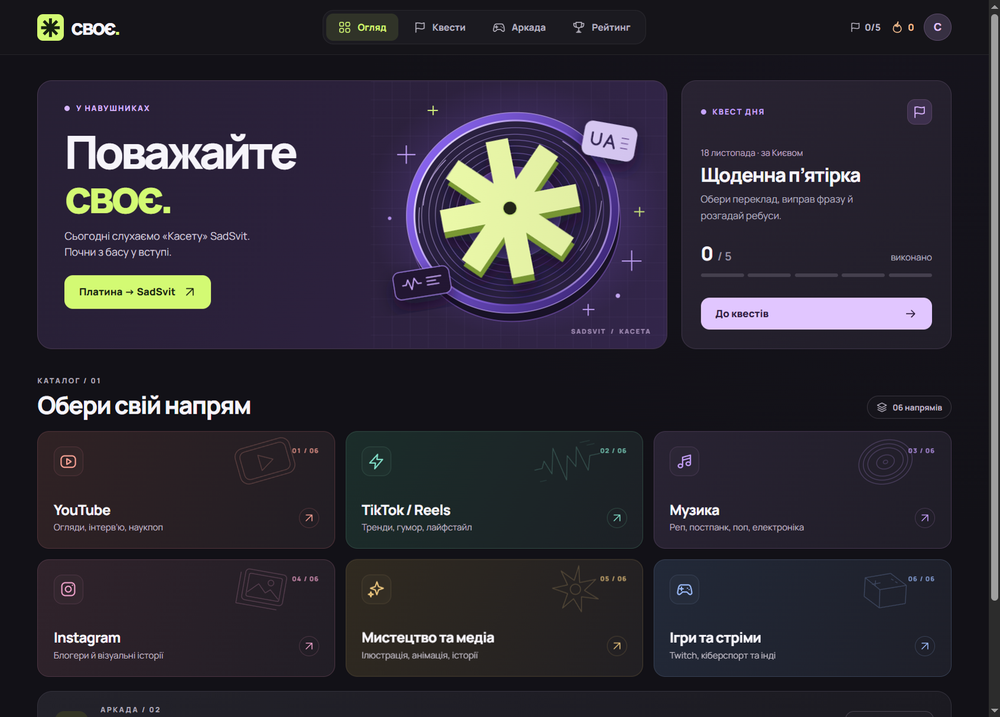

# Поважайте своє

Увімкни «Касету» SadSvit, якщо шукаєш щось для плейліста з Платиною. Відкрий Geek Journal, якщо любиш довгі розбори кіно. У каталозі 14 таких пар: музика, YouTube, TikTok і Reels, Instagram, мистецтво, ігри та стріми.



## Встановлення

- **Android:** [завантаж APK](https://github.com/gnatukroma99-hash/Ukr-social_project/raw/refs/heads/main/downloads/Povazhaite-Svoie-Android.apk), відкрий його на телефоні й підтвердь встановлення. Це тестова версія для Android 6 і новіших з актуальним Android System WebView.
- **Windows 10/11, x64:** [завантаж ZIP із релізу](https://github.com/gnatukroma99-hash/Ukr-social_project/releases/latest/download/Povazhaite-Svoie-Windows-x64.zip), **розпакуй усю папку** й запусти `PovazhaiteSvoie.exe`.
- **iPhone:** у `ios/` є проєкт Xcode. Для встановлення на пристрій потрібні macOS і підпис Apple. Інструкція нижче.

Каталог, закладки, аркада й особисті квести працюють без інтернету. Інтернет потрібен, щоб перейти до автора або відкрити сторінку підтримки Ukraїner.

## Як зіграти разом

1. Підключіть телефони і ПК до однієї Wi-Fi мережі.
2. На ПК відкрий **Профіль → Створити клуб у Wi-Fi → Запустити й приєднатися**. Windows може запитати дозвіл на доступ у приватній мережі.
3. На телефоні торкнися аватара або відкрий **Меню → Мій профіль**. Введи адресу з екрана ПК і свій псевдонім. ПК має лишатися увімкненим, поки хтось грає. Домашня гостьова Wi-Fi мережа може ізолювати пристрої один від одного.
4. Перед першою відповіддю вибери, де граєш сьогодні: особисто чи у клубі. В особистому режимі ти бачиш свої бали; у клубі всі учасники бачать спільну таблицю. Для свого другого пристрою скористайся кодом профілю з того самого клубу.

### Квести та рейтинг

Опівночі за Києвом відкриваються п’ять завдань: переклади, ребуси й короткі речення на редагування. За правильну відповідь отримуєш 20 балів. Розв’яжеш ребус за 8 секунд або менше — додаси 5 балів, за 15 секунд або менше — 3. За завершений день отримаєш ще `5 × довжина серії`, максимум 35.

На початку наступного місяця сервер підбиває підсумки під час першого звернення. Сто учасників із найвищими результатами отримують бейдж «Майстер слова» із місцем і місяцем. Якщо гравців менше, в таблиці буде стільки рядків, скільки грало. Очки зі свайп-гри до заліку не входять.

### Пропозиції та відгуки

Відкрий **Підтримка → Додати пару**. У клубі пропозиція потрапить до модератора. На ПК організатор відкриває **Профіль → Модерація**, переглядає посилання і додає пару до каталогу всіх учасників клубу. Пропозиції власників бейджа він побачить першими. В особистому режимі можна зберегти чернетку або надіслати її команді через GitHub Issues.

## Збірка з коду

Потрібен Node.js 24 або новіший. Із кореня репозиторію:

```sh
npm ci
npm test
npm start
```

Якщо npm пропустив встановлення Electron, виконай `node node_modules/electron/install.js`. `npm run windows` збере папку `release/PovazhaiteSvoie-win32-x64`. `node node_modules/electron/cli.js tools/check-ui.cjs` перевірить інтерфейс в окремому тимчасовому профілі; для цього потрібні графічна сесія та вільний порт 4387.

**Android:** встанови JDK 21 та Android SDK 35. Задай `JAVA_HOME` і `ANDROID_HOME`, виконай `npm run android:sync`, далі `cd android` і `./gradlew assembleDebug` (у Windows: `.\gradlew.bat assembleDebug`). APK з’явиться у `android/app/build/outputs/apk/debug/`. Опублікована тестова збірка може мати інший підпис, ніж локальна.

**iOS:** на Mac виконай `npm ci`, `npm run ios:sync` та `npx cap open ios`. Вибери свою команду в **Signing & Capabilities** і запусти проєкт на симуляторі або підключеному iPhone. Перевірку на фізичному iPhone ще не проводили.

**Окремий сервер для постійного клубу:** на машині з Node запусти `npm run server`. Типова адреса — `127.0.0.1:4387`; `HOST`, `PORT`, `DB_PATH` можна задати через середовище. Для доступу з інтернету постав HTTPS reverse proxy перед сервером і введи його адресу в профілі. Клуб на ПК зберігає базу у своїй папці даних Electron, окремий сервер — у `server/data/svoie.sqlite`. Для зовнішнього сервера модератор переглядає чергу командою `node server/moderate.mjs list` і приймає пропозицію через `node server/moderate.mjs approve <id>`.

## Де вносити зміни

| Що змінити | Файл |
| --- | --- |
| Автори, посилання, словник і завдання | `app/data.mjs` |
| Правила балів, днів і серій | `app/engine.mjs` |
| Тексти головної, квестів та рейтингу | `app/views.mjs` |
| Контакти, профіль і підтримка | `app/community.mjs` |
| Кольори | `app/style.css`, змінні у `:root` |
| Правила для текстів | [AGENTS.md](AGENTS.md) · [Stop Slop](.opencode/skills/stop-slop/SKILL.md) |

Ілюстрації й піктограми лежать у `app/assets` та `app/icons.mjs`. Шрифт Manrope: [SIL Open Font License](app/assets/OFL-Manrope.txt).
